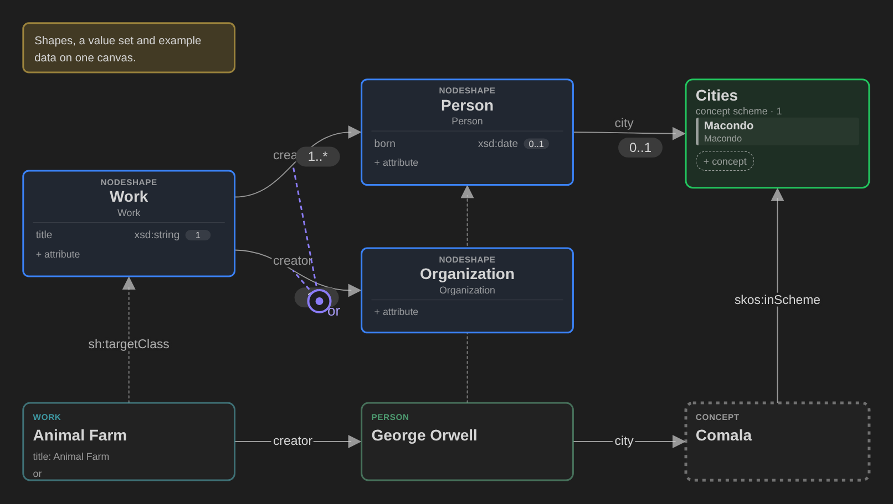

# Catenary

A scribble tool for RDF models. Sketch shapes and instances on a canvas, in any order, until the model is consistent. Then write it up with diagrams and share it.



- **Site**: [cristianvasquez.github.io/catenary](https://cristianvasquez.github.io/catenary/), with [what Catenary is](https://cristianvasquez.github.io/catenary/what-is-catenary) and a [tutorial](https://cristianvasquez.github.io/catenary/tutorial/01-new-workspace) that builds a small model from an empty folder.
- **Download**: the [releases](https://github.com/cristianvasquez/catenary/releases) page, for Linux, Windows and macOS.

Catenary is a personal tool for small datasets. It is incomplete, and it does not replace mature RDF tools. I add a function when I need it, so progress is slow. The ergonomics are still rough: suggestions are welcome in the [issues](https://github.com/cristianvasquez/catenary/issues). Each edit writes the files at once: use a copy of valuable data.

## For developers and agents

The rest of this file is the technical reference: the documentation map, the build, the release packages and the command-line interface.

### Documentation

Read in this order, from overview to detail:

| Document | Content |
|---|---|
| [Overview](docs/overview.md) | Purpose, main ideas, vocabulary |
| [Architecture](docs/architecture.md) | Data flow, store layout, packages, code map, persistence, testing |
| [Vocabularies](www/public/vocab/) | The `view:`, `ws:` and `nt:` vocabularies in Turtle. `pnpm www:vocab` writes their site pages to `www/vocab/` |
| [Notation shapes](docs/notation/) | The SHACL of views, placements and notations (ADR 0014) |
| [Data contract](spec/manifest.hs) | Files, RDF, commands, transactions, persistence, queries, CLI protocol |
| [Interaction contract](spec/ui-manifest.hs) | Interaction rules, keys, selection, panels, controls |
| [Open work](spec/open.md) | Open decisions, known defects, verification gaps |
| [Agent guide](AGENTS.md) | Work rules for agents and documentation style |
| [Site](www/) | What Catenary is, a tutorial, and the reference of each panel (VitePress, GitHub Pages) |
| [rdf-files](packages/rdf-files/readme.md) | The RDF files package: modules, WASM files, grammar build, limits, tests |

The contracts are Haskell modules. The optional `pnpm check:manifests` target typechecks them with GHC. It skips the check when GHC is absent. A mismatch of names or types fails when GHC is available.

### Run

Use Node 22.23.3 and pnpm 11.3.0. Dependencies: Theia 1.74.1, GLSP 2.8.0, [shaclxtract](https://www.npmjs.com/package/shaclxtract).

```sh
pnpm install          # dependencies, native drivelist, Electron, VS Code Git plugin
pnpm build            # packages, extension, browser app and Electron app
pnpm start            # browser app: http://localhost:3100, example workspace
pnpm desktop          # Electron app on the example workspace
pnpm install-desktop  # Linux launcher entry
pnpm package linux-x64   # portable package in dist/: linux-x64, win32-x64, darwin-x64, darwin-arm64
pnpm package linux-x64 --appimage  # also dist/Catenary-linux-x64.AppImage
node scripts/check-windows-package.mjs   # layout and binaries of the Windows package (pnpm package:win first)
xvfb-run -a node scripts/smoke-desktop.mjs   # start the desktop app and check paths, writes, Git, watcher
pnpm test             # source-based tests
pnpm -s test --sequence.shuffle --sequence.seed=42 --maxWorkers=4   # shuffled order; the same seed repeats the order
pnpm test:perf        # elapsed-time budgets (manifest §11.3); not in pnpm verify; diagnostic unless CATENARY_PERF_ENV names a controlled environment
pnpm check            # package boundaries, Markdown links, CSS and TypeScript
pnpm check:manifests  # optional manifest typecheck with GHC; skips when GHC is absent
pnpm build:browser    # the build without the Electron app
pnpm www:dev          # the site (www/) with live reload; www:build and www:preview build and serve it
pnpm www:screenshots  # regenerate the pictures of the site from the built browser app (needs Chromium)
pnpm www:vocab        # write the vocabulary pages www/vocab/*.md from www/public/vocab/*.ttl (needs the rdf-files build)
pnpm migrate-vocab <folder> [--dry-run]   # rewrite old osg://vocab/ namespaces to the published ones, in place
node scripts/smoke-cli.mjs      # CLI and RPC contract against the browser backend (build first)
pnpm verify           # check → test → build, stops at the first failure
pnpm verify --e2e     # also run browser smoke tests
E2E_LIST=1 pnpm e2e   # list the browser scenario names; starts nothing
E2E_TEST='<exact name>' pnpm e2e   # run one browser scenario; an unknown name fails with exit code 1
E2E_REPLY_DELAY_MS=300 E2E_TEST='<exact name>' pnpm e2e   # editors scenarios: each model-service reply of the window arrives 300 ms late
```

`pnpm e2e` (`scripts/e2e.cjs`) runs the browser scenarios of `scripts/e2e/`. `E2E_CONCURRENCY` sets the number of parallel scenarios (default 3). A failed scenario that starts a backend keeps its temporary folder (`$TMPDIR/catenary-<name>-*`). The two rendering checks start no backend and keep no folder. The folder holds the workspace, the configuration, `backend-browser.log`, `diagnostics.json` (phase, URL, backend exit code and signal, last CLI commands, browser errors), `failure.png` and `page.html`.

Canvas command `catenary.copyAsRdf` copies selected model RDF as readable Turtle without placement metadata.
RPC queries `prepareRdfPaste(text, mediaType?)` and `copyAsRdf(viewId, ids)` parse and export clipboard RDF.
The `pasteRdf` edit accepts parsed N-Quads, a view, an optional position, and explicit consent to flatten named graphs.

By default, the first start copies [`examples/bookshop`](examples/bookshop/readme.md) to `~/.local/share/catenary/workspaces/example` or `$XDG_DATA_HOME/catenary/workspaces/example`. Catenary edits the copy, not the tracked example, and does not overwrite a non-empty workspace. Set `CATENARY_WORKSPACE` to use another folder. For another desktop workspace, use `bash scripts/desktop.sh <folder>`. Each workspace gets its own Electron profile in `~/.config/catenary/profiles/<hash>`, so each workspace runs in its own process with its own backend. A second launch on the same workspace focuses the open window. `--user-data-dir=<dir>` overrides the profile. Backend logs of all instances also go to `~/.local/state/catenary/backend.log`.

The Windows package is built on Linux. The workflow `.github/workflows/windows.yml` checks it on a Windows runner. It runs on demand (Actions → Windows → Run workflow) and when a change touches the package scripts, the desktop app or the lockfile. It runs the tests of paths, files, the watcher and Git with real Windows paths, and it starts `Catenary.exe` and `Catenary.cmd` with `scripts/smoke-desktop.mjs dist\Catenary-win32-x64 [--crlf | --launcher]`.

The install script builds `drivelist` in a temporary directory because node-gyp fails on some paths with spaces. Both applications load the downloaded plugins for Source Control with `--plugins=local-dir:plugins`.

### Releases

The [release workflow](.github/workflows/release.yml) builds portable packages for Linux, Windows and macOS. To publish a release, push a version tag:

```sh
git tag v0.1.0
git push origin v0.1.0
```

The workflow publishes only a commit whose CI run on `main` passed. It builds on Linux with `scripts/package.sh`, starts each package once, signs the macOS apps ad hoc on macOS and attaches these files to a GitHub release:

| File | Platform | Start |
|---|---|---|
| `Catenary-linux-x64.tar.gz` | Linux x64 (glibc 2.35 or later) | `./catenary` |
| `Catenary-linux-x64.AppImage` | Linux x64 (glibc 2.35 or later) | `chmod +x` the file, then run it |
| `Catenary-win32-x64.zip` | Windows x64 | `Catenary.exe` |
| `Catenary-darwin-arm64.dmg`, `.zip` | macOS, Apple silicon | `Catenary.app` |
| `Catenary-darwin-x64.dmg`, `.zip` | macOS, Intel | `Catenary.app` |

A tag with a hyphen, for example `v0.2.0-rc.1`, makes a prerelease. A pull request that changes the packaging files, or a manual run, builds the packages as workflow artifacts without a release. The packages have no Apple or Windows code signature:

- macOS: after you copy Catenary to Applications, run `xattr -dr com.apple.quarantine /Applications/Catenary.app`. Alternatively, open it once from System Settings → Privacy & Security → Open Anyway.
- Windows: SmartScreen can show a warning. Select More info → Run anyway. Source Control needs `git.exe` on the PATH.
- Linux: the AppImage needs FUSE 2 (`libfuse2`). Without FUSE, run it with `--appimage-extract-and-run`. The AppImage turns off the Electron sandbox when the kernel does not allow unprivileged user namespaces, for example on Ubuntu 24.04. If the tar.gz package stops with a sandbox error, run `./catenary --no-sandbox`, or give `chrome-sandbox` to root with mode 4755.

### Command-line interface

`pnpm -s catenary` controls a running backend. Use `--help` for syntax and `rpc` for the available methods. Each backend writes `$XDG_RUNTIME_DIR/catenary/<pid>.json` (port, token, workspace). The CLI selects the backend from `--port`, then `CATENARY_PORT`, then the only running backend, then the backend of the workspace that contains the current directory. Otherwise it fails and lists the running backends. `--workspace PATH` selects the backend whose loaded model file is PATH (a `.trig` file) or is inside PATH (a folder). The CLI asks each backend for its `status` to find the loaded file, because the discovery file keeps the start folder also after File > Open. With no match or several matches, the CLI exits with code 2 and lists each backend with its port and loaded file. `--port` with `--workspace` also gives exit code 2. The CLI does not retry after a lost connection. After a backend restart on a new port, the next call with `--workspace` finds the new port. The [data contract](spec/manifest.hs) defines authentication and exit codes.

The CLI refuses a backend with an older CLI protocol (`cliProtocol` in the discovery file and in `status`) for each command except `status` and `instances`: restart the backend.

The CLI writes all output before it exits, so a large result (`rpc view`, `rpc trace`) stays valid JSON in a pipe. When the reader closes the pipe early (`| head`), the CLI exits with the code of the result and prints no error.

```sh
pnpm -s catenary --port 3917 status
pnpm -s catenary --port 3917 rpc open '"/tmp/catenary-test/workspace.trig"'
pnpm -s catenary --port 3917 model views --keys
pnpm -s catenary --port 3917 exec '{"kind":"createView","label":"Test view"}'
pnpm -s catenary --port 3917 commands view
pnpm -s catenary --port 3917 run catenary.newInstance
pnpm -s catenary --port 3917 prompt
pnpm -s catenary --port 3917 answer --pick Dataset
pnpm -s catenary --port 3917 answer --cancel
pnpm -s catenary --port 3917 run catenary.exportMarkdown '"/tmp/catenary-test/docs"' '"/tmp/catenary-out"'
pnpm -s catenary --port 3917 run catenary.exportMarkdown '["/tmp/catenary-test/docs/a.md","/tmp/catenary-test/notes"]' '"/tmp/catenary-out"'
pnpm -s catenary --port 3917 run catenary.runLastMarkdownExport
pnpm -s catenary --port 3917 open-view '<view-id>' --fit
pnpm -s catenary --workspace /tmp/catenary-test status
```

`open-view <view-id>` opens and activates a view in the connected window (command `catenary.openView`) and prints `currentView`. It exits 0 only when `currentView` is the requested view. An unknown view gives exit 1 and the message "The requested view is not in the current workspace."

`status`, `model`, `rpc` and `exec` need no browser window. The other commands need a connected window. A headless Chromium page is sufficient. Before a test, `status` must report `build.stale`, `build.restartNeeded` and each window's `reloadNeeded` as false. A backend without a frontend starts with an empty model, so open the test workspace explicitly. Keep the backend on localhost.

`exec` and the reads of `rpc` take an IRI where they take an ID, and a relation as `{"s":IRI,"p":IRI,"o":IRI}`. A value with `:` is an IRI. A CURIE is not expanded. The IRI of a property shape gives its `p-` ID. An unknown ID or IRI on a read gives `result: null`, an `error` that names the value, and exit 1. A command result gives `iri` next to `id`, and `iris` next to `ids`.

```sh
pnpm -s catenary --port 3917 rpc properties '"urn:name:Query%20service"'
pnpm -s catenary --port 3917 exec '{"kind":"addToView","view":"urn:name:Product%20context","ids":["urn:name:Query%20service"],"at":{"x":0,"y":0}}'
pnpm -s catenary --port 3917 exec '{"kind":"delete","ids":[{"s":"urn:name:A","p":"http://www.w3.org/ns/dcat#distribution","o":"urn:name:B"}]}'
```

`exec` with a JSON array runs a batch: one transaction, one undo step, one write and, with `ws:autoCommit`, one Git commit. `exec -` reads the same batch as NDJSON from stdin, one command per line. A string `"$N"` in a command is the result ID of command N (0-based, an earlier command). If one command fails, nothing changes: the result gives `index` and `error`, and the exit status is 1. A batch cannot contain `moveElementsToFile` or `migrateData`, more than one new view when one of them has `file` or `folder`, or `addFileReference` to a view of the same batch.

```sh
pnpm -s catenary --port 3917 exec '[{"kind":"createInstance","classIri":"http://www.w3.org/ns/dcat#Dataset","label":"Sales"},{"kind":"addToView","view":"urn:name:Product%20context","ids":["$0"],"at":{"x":0,"y":0}}]'
printf '%s\n' '{"kind":"createView","label":"Plan"}' '{"kind":"createNote","view":"$0","text":"Draft","at":{"x":0,"y":0}}' | pnpm -s catenary --port 3917 exec -
```

`rpc view <view-id> <ids>` reads selected placements and their dependencies. Omit `ids` to read the full view. Both arguments are JSON.

`rpc search '{"text":"robot","kind":"instance","limit":10}'` returns a list of hits. The filter keys are `text` (a case-insensitive part of the label, IRI or a type), `kind`, `type` (a class IRI), `view` (a view ID or IRI), `limit` and `skolem`. A filter excludes `urn:skolem:` subjects unless `skolem` is true. An unknown key fails with exit 1. Without a filter, `rpc search` returns all things.

`rpc viewDescription '"<view-id>"'` reads only a view's Markdown description, without diagram counts. See the Trace section of [the site](www/reference/properties.md) for the five Trace metrics.

`rpc setTracing true` starts the trace of the backend for the CLI connection, `rpc trace 0` reads the spans and totals, and `rpc setTracing false` stops it. Figure synchronization spans identify notation input, per-view derivation and placement-rule time. Canvas refresh spans and snapshot spans are listed in the Trace section of [the site](www/reference/properties.md). `rpc stopTracing 0` returns the final batch before stopping the CLI connection. Read spans show the RDF view ID, instance count and file-origin query count under the calling RPC. The Trace panel (View → Trace) shows the same data.

Model RDF files open as file-scoped Model documents. **Open as…** (`catenary.openAs`) and **Open beside…** (`catenary.openBeside`) select a presentation. Both accept a file path and a presentation name: `Source`, `Model`, `Canvas`, or `Settings`. Reopening focuses the existing pane. `explorerChildren(key, file, offset)` returns one page of rows of a source file. `explorerSearch(text, file)` returns the flat filter list. `explorerDrag(selection)` resolves complete folder contents. The `moveElementsToFile` edit moves source statements, and `placeExplorerElements` places a mixed selection in one undo step.

## License

Copyright (C) 2026 Cristian Vasquez.

Catenary is free software: you can redistribute it and modify it under the terms of the [GNU Affero General Public License](LICENSE) as published by the Free Software Foundation, version 3 of the License or any later version. Catenary has no warranty. See the license for details.
